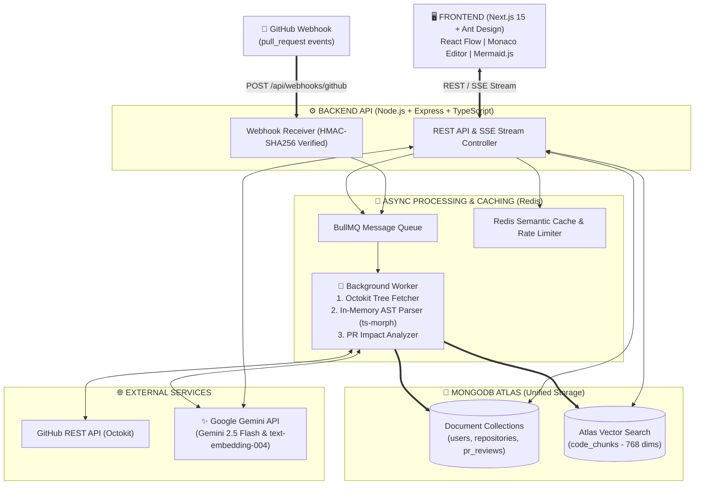

# 🔍 CodeLens AI — Codebase Architecture Visualizer & Automated PR Reviewer

> **Nền tảng Trực quan hóa Kiến trúc Mã nguồn bằng AST, Trợ lý Hỏi đáp Code-Aware RAG & Tự động Review Pull Request thời gian thực.**

[](https://www.typescriptlang.org/)
[](https://nextjs.org/)
[](https://expressjs.com/)
[](https://www.mongodb.com/atlas)
[](https://redis.io/)
[](https://ai.google.dev/)

---

## 🎯 Bài toán & Giá trị cốt lõi

Khi tham gia một dự án phần mềm mới (Onboarding) hoặc tiếp nhận các Repository lớn, lập trình viên thường mất hàng tuần để đọc hiểu luồng phụ thuộc giữa hàng trăm files. Các công cụ RAG thông thường thất bại khi áp dụng vào mã nguồn vì chúng cắt văn bản máy móc theo số ký tự, làm đứt gãy cấu trúc hàm/lớp và bỏ qua mối quan hệ `import/export`.

**CodeLens AI** giải quyết triệt để vấn đề này thông qua 3 trụ cột kỹ thuật:
1. **AST-Based Dependency Graph:** Phân tích cây cú pháp trừu tượng (`ts-morph`) trên bộ nhớ đệm (In-Memory) để bóc tách chính xác từng `Function`, `Class`, `React Component` và vẽ bản đồ phụ thuộc tương tác bằng **React Flow**.
2. **Graph-Expanded Code RAG:** Kết hợp tìm kiếm ngữ nghĩa (**MongoDB Atlas Vector Search** 768 chiều) với việc mở rộng ngữ cảnh theo đồ thị phụ thuộc (`Dependency Graph`), trả lời kèm trích dẫn dòng code (`[filePath:startLine-endLine]`) và tự động sinh sơ đồ **Mermaid Sequence Diagram** qua **Server-Sent Events (SSE)**.
3. **Impact-Aware PR Auto-Reviewer:** Tích hợp **GitHub Webhook** tự động phân tích `git diff` khi có Pull Request mới, đối chiếu các file bị ảnh hưởng để chấm điểm rủi ro và đăng nhận xét trực tiếp lên GitHub.

---

## 🏗️ Kiến trúc Hệ thống Tổng thể (System Architecture)



---

## 🛠️ Tech Stack Chi tiết

| Tầng (Layer) | Công nghệ sử dụng | Lý do lựa chọn (Architectural Decisions) |
| :--- | :--- | :--- |
| **Monorepo** | `npm workspaces`, TypeScript 5 | Chia sẻ 100% kiểu dữ liệu (`@codelens/shared`) giữa Frontend và Backend, tránh sai lệch hợp đồng API. |
| **Frontend** | Next.js 15, Ant Design v5, `@xyflow/react`, `@monaco-editor/react`, `mermaid`, Zustand | Xây dựng giao diện Workspace đa khung nhìn mượt mà; đồng bộ hóa trạng thái giữa Node đồ thị, khung xem code và khung Chat. |
| **Backend** | Node.js, Express, TypeScript, Zod | Kiến trúc phân tầng (`Controller - Service - Model - Worker`) gọn nhẹ, kiểm soát luồng SSE Streaming và Raw Body Webhook trực tiếp. |
| **Queue & Cache** | Redis, BullMQ (`ioredis`) | Đảm bảo Non-blocking I/O khi quét Repository lớn; lưu Semantic Cache giảm thời gian phản hồi xuống `<50ms` cho câu hỏi trùng lặp. |
| **Code Analysis** | `ts-morph` (TypeScript Compiler API), `@octokit/rest` | Quét cây thư mục qua API mà không cần `git clone` tốn ổ cứng; phân tích AST hoàn toàn trên RAM để lấy chính xác tọa độ dòng code. |
| **Database** | MongoDB Atlas + Mongoose | Lưu trữ cả đồ thị JSON (`nodes/edges`) lẫn Vector Embeddings 768 chiều với bộ lọc trước (`Pre-filtering`) trên cùng một nền tảng. |
| **AI Engine** | `@google/genai` (Gemini 2.5 Flash & `text-embedding-004`) | Tốc độ sinh token vượt trội, cửa sổ ngữ cảnh lớn (1M tokens), tối ưu chi phí vận hành. |

---

## 📚 Tài liệu Thiết kế Kỹ thuật (System Design Docs)

Toàn bộ tài liệu phân tích nghiệp vụ, sơ đồ UML và đặc tả kỹ thuật được lưu trữ chi tiết trong thư mục [`/docs`](./docs):

1. 📋 [**01. Đặc tả Yêu cầu, User Stories & Sơ đồ Use Case**](./docs/01-requirements-and-usecases.md)
2. 🔄 [**02. Sơ đồ Tuần tự (Sequence Diagrams: AST Ingestion, RAG & PR Webhook)**](./docs/02-sequence-diagrams.md)
3. 🗄️ [**03. Thiết kế Cơ sở dữ liệu (ERD) & Cấu hình Vector Index**](./docs/03-database-erd.md)
4. 🔌 [**04. Đặc tả RESTful API, SSE Protocol & Kiến trúc System Prompt**](./docs/04-api-and-ai-prompts.md)

---

## 🚀 Hướng dẫn Cài đặt & Khởi chạy (Quick Start)

### 1. Yêu cầu môi trường
* **Node.js** `>= 20.x`
* **Docker** (để chạy Redis local) hoặc URI của Upstash Redis
* Tài khoản **MongoDB Atlas** (Free Cluster M0) và **Google Gemini API Key**

### 2. Cài đặt và chạy dự án
```bash
# 1. Clone repository
git clone [https://github.com/](https://github.com/)<your-username>/codelens-ai.git
cd codelens-ai

# 2. Cài đặt toàn bộ dependencies cho cả Monorepo (shared, server, web)
npm install

# 3. Khởi chạy Redis qua Docker Compose
docker-compose up -d

# 4. Tạo file biến môi trường cho Backend
cp apps/server/.env.example apps/server/.env
# (Cập nhật MONGODB_URI, GEMINI_API_KEY và GITHUB_TOKEN trong apps/server/.env)

# 5. Khởi chạy đồng thời Express Server (Port 4000) và Next.js Web (Port 3000)
npm run dev
```

---

## 💡 Thách thức Kỹ thuật & Giải pháp (Engineering Highlights)

* **Vấn đề 1: Đứt gãy ngữ cảnh khi cắt nhỏ mã nguồn (Naive Text Splitting)**
  * *Giải pháp:* Thay vì cắt theo mỗi 500 ký tự, `AstParserService` sử dụng `ts-morph` để duyệt cây cú pháp, tách riêng từng hàm/lớp nguyên vẹn kèm theo danh sách `dependencies` (các file được `import`).
* **Vấn đề 2: Nghẽn cổ chai (Blocking) khi phân tích Repository lớn**
  * *Giải pháp:* Áp dụng bộ lọc thông minh ngay từ bước gọi GitHub Tree API (loại bỏ `node_modules`, `dist`, `.lock`, binary files), sau đó đẩy tác vụ vào **BullMQ Worker** xử lý ngầm và phát tiến độ (%) theo thời gian thực qua kết nối **Server-Sent Events (SSE)**.