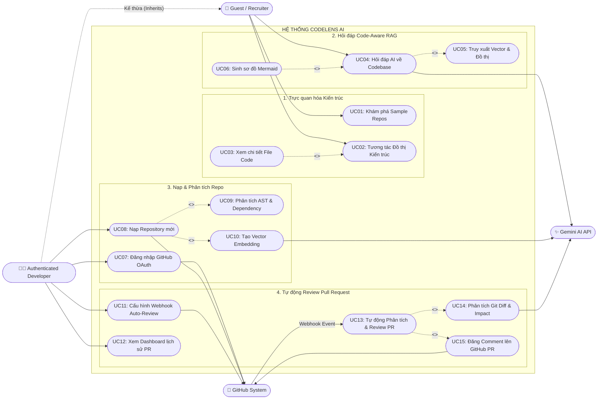

# 01. Đặc tả Yêu cầu Nghiệp vụ & Sơ đồ Use Case

## 1. Xác định các Tác nhân (System Actors)

Hệ thống **CodeLens AI** tương tác với **4 Actors** chính (2 tác nhân con người và 2 tác nhân hệ thống bên ngoài):

1. **Guest / Recruiter (Khách / Nhà tuyển dụng):** Người truy cập bản Live Demo, muốn trải nghiệm ngay lập tức đồ thị kiến trúc và khả năng hỏi đáp AI trên các dự án mẫu (Sample Repositories) mà không cần đăng ký tài khoản hay chờ đợi quét code.
2. **Authenticated Developer (Lập trình viên đã đăng nhập):** Người dùng chính, xác thực qua GitHub OAuth để nạp Repository cá nhân, khám phá kiến trúc mã nguồn và cấu hình tự động review Pull Request.
3. **GitHub System (External System):** Cung cấp dữ liệu cây thư mục/mã nguồn qua GitHub REST API và chủ động bắn sự kiện Webhook khi có Pull Request mới.
4. **Gemini AI API (External System):** Cung cấp dịch vụ chuyển đổi văn bản/code thành Vector 768 chiều (`text-embedding-004`) và mô hình ngôn ngữ lớn (`gemini-2.5-flash`) cho luồng RAG & Code Review.

---

## 2. Danh sách User Stories (Agile Standard)

| Mã | Vai trò (As a...) | Hành động (I want to...) | Giá trị nhận được (So that...) | Độ ưu tiên |
| :--- | :--- | :--- | :--- | :--- |
| **US-01** | **Guest / Recruiter** | Trải nghiệm ngay trên các dự án mẫu (Sample Repos) có sẵn chỉ với 1 cú click | Đánh giá được toàn bộ tính năng của hệ thống trong 30 giây mà không cần đăng nhập hay chờ đợi hệ thống quét code. | **Must-have** |
| **US-02** | **Developer** | Đăng nhập bằng tài khoản GitHub và dán URL của một Repository bất kỳ | Hệ thống tự động bóc tách mã nguồn, phân tích cấu trúc mà không cần tải code về máy cá nhân. | **Must-have** |
| **US-03** | **Developer** | Xem bản đồ kiến trúc dự án dưới dạng đồ thị tương tác (Interactive Node Graph) | Nhìn thấy tổng quan file nào đang phụ thuộc (`import`) vào file nào và click vào từng node để đọc code chi tiết. | **Must-have** |
| **US-04** | **Developer** | Hỏi đáp với AI về một luồng nghiệp vụ bất kỳ trong dự án | Nhận được câu trả lời giải thích chi tiết kèm **trích dẫn chính xác dòng code (Citation)** và **sơ đồ luồng (Mermaid Sequence Diagram)**. | **Must-have** |
| **US-05** | **Developer** | Kích hoạt tính năng Auto-Review cho Repository của mình | Mỗi khi có thành viên tạo Pull Request mới, AI tự động kiểm tra lỗi tiềm ẩn và đăng nhận xét trực tiếp lên GitHub. | **Should-have** |
| **US-06** | **Developer** | Xem bảng thống kê lịch sử các lần Review Pull Request (Dashboard) | Theo dõi điểm số rủi ro (Risk Score) và các lỗi phổ biến mà AI đã phát hiện trong dự án. | **Could-have** |

---

## 3. Yêu cầu Hệ thống (System Requirements)

### A. Yêu cầu Chức năng (Functional Requirements - FR)
* **FR1 - Quản lý & Nạp Repository (Repo Ingestion):**
  * **FR1.1:** Xác thực người dùng thông qua GitHub OAuth.
  * **FR1.2:** Kiểm tra tính hợp lệ của GitHub URL, lọc bỏ các thư mục rác (`node_modules`, `.git`, `dist`, file media) và giới hạn số lượng file (tối đa 80 files cho bản Demo).
  * **FR1.3:** Phân tích cây cú pháp trừu tượng (AST Parsing) để trích xuất danh sách hàm, class, component và mối quan hệ `import/export`.
  * **FR1.4:** Chia nhỏ code theo từng hàm/class (Code Chunking), gọi AI tạo Vector Embeddings và lưu vào MongoDB Atlas.
* **FR2 - Trực quan hóa Kiến trúc (Architecture Visualization):**
  * **FR2.1:** Hiển thị đồ thị phụ thuộc (Dependency Graph) gồm các Đỉnh (Files/Modules) và Cạnh (Mối quan hệ gọi nhau).
  * **FR2.2:** Lọc đồ thị theo loại module (`controller`, `service`, `model`, `component`) hoặc tìm kiếm nhanh tên file.
  * **FR2.3:** Mở trình xem code (Code Viewer) nhảy đến đúng dòng code tương ứng khi người dùng click vào một Node hoặc một trích dẫn.
* **FR3 - Trợ lý Hỏi đáp Mã nguồn (Code-Aware RAG Chat):**
  * **FR3.1:** Tìm kiếm kết hợp (Hybrid Search: Vector ngữ nghĩa + mở rộng theo đồ thị phụ thuộc) trên MongoDB.
  * **FR3.2:** Phản hồi câu trả lời theo thời gian thực (Streaming qua SSE) kèm theo mã vẽ sơ đồ `Mermaid.js`.
* **FR4 - Tự động Review Pull Request (Automated PR Reviewer):**
  * **FR4.1:** Tiếp nhận và xác thực chữ ký bảo mật (`X-Hub-Signature-256`) từ sự kiện `pull_request` của GitHub.
  * **FR4.2:** Lấy dữ liệu thay đổi (`git diff`), đối chiếu với các file liên quan trong Database (Impact Analysis) và gửi cho AI đánh giá.
  * **FR4.3:** Tự động đăng bình luận (Comment) kết quả review lên trang Pull Request của GitHub và lưu log vào hệ thống.

### B. Yêu cầu Phi chức năng (Non-Functional Requirements - NFR)
* **NFR1 - Hiệu năng & Bất đồng bộ (Performance & Async):** Quá trình nạp và phân tích một Repository (50–80 files) phải được đẩy xuống Background Worker (BullMQ + Redis), không làm treo giao diện và hoàn thành trong vòng **dưới 45 giây**.
* **NFR2 - Độ trễ phản hồi (Latency):** Thời gian trả về chữ đầu tiên (Time to First Token) trong khung Chat AI phải **nhỏ hơn 2 giây** nhờ cơ chế Streaming.
* **NFR3 - Bảo mật & Chống lạm dụng (Security & Rate Limiting):** Giới hạn mỗi IP/User chỉ được nạp tối đa 3 Repositories/ngày và gửi 20 tin nhắn/phút để bảo vệ hạn mức API (Quota).

---

## 4. Sơ đồ Use Case Tổng thể (Mermaid Use Case Diagram)

