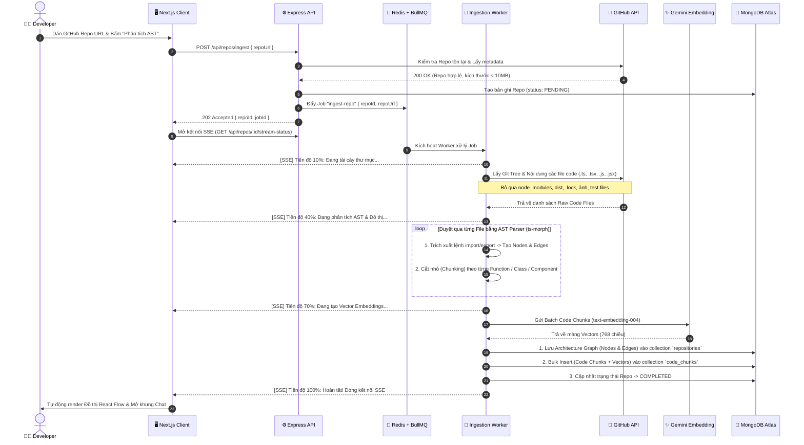
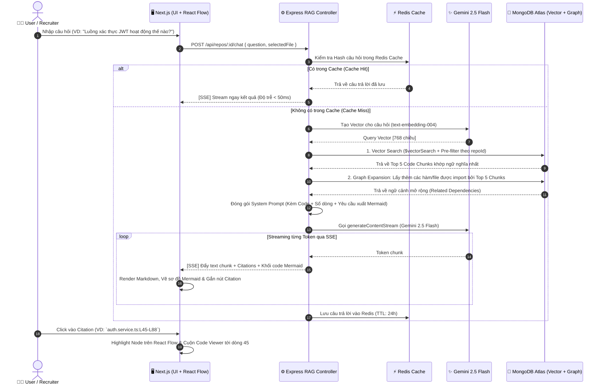
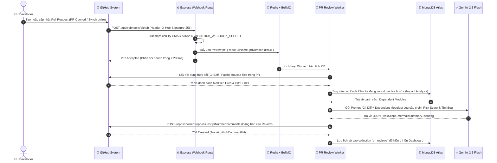

# 02. Sơ đồ Tuần tự (System Sequence Diagrams)

Tài liệu này mô tả chi tiết luồng tương tác tuần tự giữa các thành phần trong 3 nghiệp vụ kỹ thuật phức tạp nhất của **CodeLens AI**.

---

## 1. Luồng Quét Repository Bất đồng bộ, Phân tích AST & Tạo Vector (Ingestion Pipeline)

**Điểm nhấn kỹ thuật:**
* **Non-blocking Response:** API trả về `202 Accepted` ngay lập tức và đẩy tác vụ nặng xuống **BullMQ Worker**.
* **Real-time Progress:** Cập nhật tiến độ phần trăm (%) thời gian thực về Frontend qua **Server-Sent Events (SSE)**.
* **In-Memory AST Parsing:** Sử dụng `ts-morph` phân tích cú pháp trên RAM, tạo đồ thị `Nodes & Edges` và cắt nhỏ mã nguồn theo từng hàm/class.

---

## 2. Luồng Hỏi đáp Code-Aware RAG, Hybrid Search & Sinh sơ đồ trực tiếp

**Điểm nhấn kỹ thuật:**
* **Semantic Caching (Redis):** Trả về kết quả tức thì (`<50ms`) nếu câu hỏi đã từng được hỏi trên cùng một Repository.
* **Graph-Expanded Retrieval:** Kết hợp kết quả từ `$vectorSearch` với việc truy xuất mở rộng các file nằm trong danh sách `dependencies` của đoạn code đó.
* **Streaming Text & Mermaid Diagram:** Vừa stream câu trả lời văn bản, vừa tự động vẽ biểu đồ luồng và gắn thẻ trích dẫn dòng code.

---

## 3. Luồng Tự động Review Pull Request qua GitHub Webhook (Impact-Aware PR Reviewer)

**Điểm nhấn kỹ thuật:**
* **HMAC-SHA256 Verification:** Xác thực chữ ký bảo mật từ GitHub trước khi xử lý.
* **Cross-File Impact Analysis:** Không chỉ đọc đoạn `git diff` đơn lẻ, hệ thống tra cứu trong MongoDB xem file vừa sửa đang được gọi bởi những module nào khác để cảnh báo lỗi dây chuyền (Breaking Changes).

