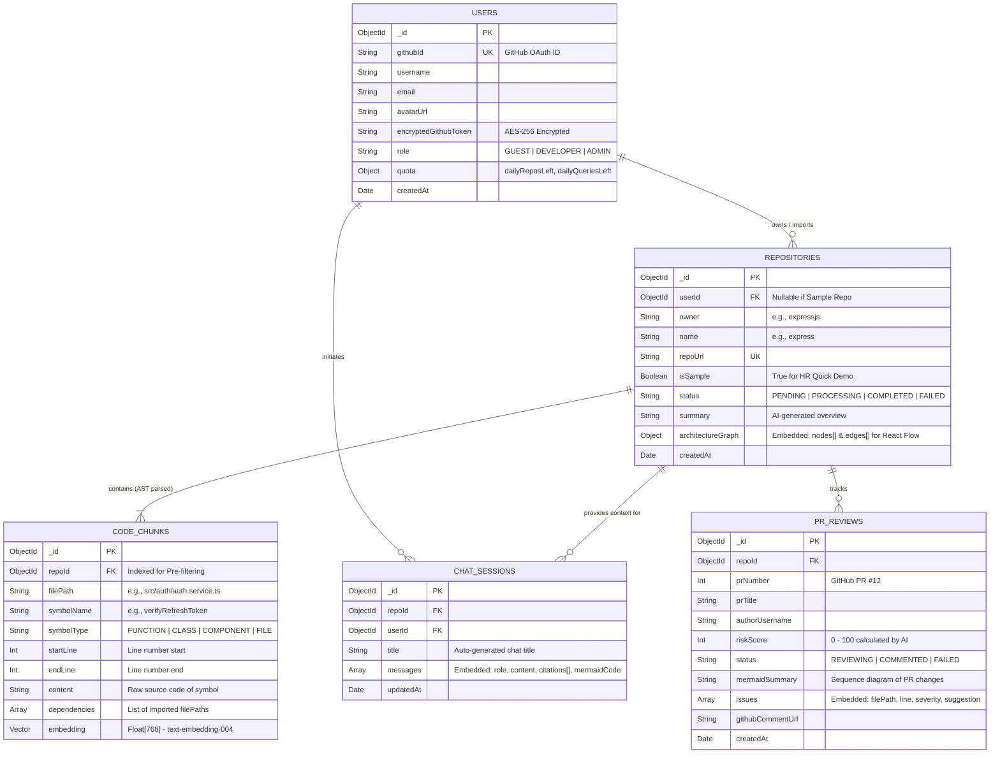

# 03. Thiết kế Cơ sở dữ liệu (MongoDB ERD) & Cấu hình Vector Index

Hệ thống sử dụng **MongoDB Atlas** làm cơ sở dữ liệu hợp nhất (Unified Database) cho cả dữ liệu tài liệu (Document Model), đồ thị phụ thuộc (`architectureGraph`) và tìm kiếm Vector (`Atlas Vector Search`).

---

## 1. Sơ đồ Thực thể Quan hệ (Entity Relationship Diagram)



---

## 2. Quyết định Thiết kế Schema: Embedded vs. Referenced

1. **Nhúng trực tiếp `architectureGraph` (`nodes[]`, `edges[]`) vào `REPOSITORIES`:**
   * Với giới hạn dưới 80 files cho mỗi Repository, kích thước JSON của toàn bộ đỉnh và cạnh chỉ khoảng `30KB – 50KB` (rất nhỏ so với giới hạn `16MB` của MongoDB Document).
   * Giúp Frontend tải toàn bộ bản đồ kiến trúc cho **React Flow** chỉ bằng 1 truy vấn `findById` duy nhất với độ trễ `<10ms`, không tốn chi phí `$lookup` (JOIN).
2. **Tách riêng `CODE_CHUNKS` thành Collection độc lập:**
   * Một Repository có thể sinh ra từ `300 – 1.000` hàm/class, mỗi bản ghi chứa mảng `embedding` gồm 768 số thực.
   * Việc tách riêng là bắt buộc để đánh chỉ mục **Atlas Vector Search** ở cấp độ từng hàm và mở rộng quy mô lên hàng trăm nghìn chunks mà không chạm giới hạn 16MB.

---

## 3. Cấu hình MongoDB Atlas Vector Search Index

Trên giao diện **MongoDB Atlas $\rightarrow$ Atlas Search $\rightarrow$ Create Search Index**, chọn JSON Editor và tạo index có tên `vector_code_index` trên collection `code_chunks`:

```json
{
  "fields": [
    {
      "type": "vector",
      "path": "embedding",
      "numDimensions": 768,
      "similarity": "cosine"
    },
    {
      "type": "filter",
      "path": "repoId"
    },
    {
      "type": "filter",
      "path": "filePath"
    },
    {
      "type": "filter",
      "path": "symbolType"
    }
  ]
}
```

### Truy vấn Aggregation Pipeline kết hợp Pre-filtering trong Express:
```typescript
const relevantChunks = await CodeChunkModel.aggregate([
  {
    $vectorSearch: {
      index: 'vector_code_index',
      path: 'embedding',
      queryVector: questionEmbedding, // Mảng 768 số thực từ text-embedding-004
      numCandidates: 100,
      limit: 6,
      filter: {
        repoId: new mongoose.Types.ObjectId(repoId), // Chỉ tìm trong đúng Repo hiện tại
      },
    },
  },
  {
    $project: {
      filePath: 1,
      symbolName: 1,
      symbolType: 1,
      startLine: 1,
      endLine: 1,
      content: 1,
      dependencies: 1,
      score: { $meta: 'vectorSearchScore' },
    },
  },
]);
```